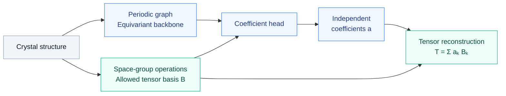

<h1 align="center">[NeurIPS 2026] IrredNet</h1>

<p align="center">
  <strong>Code for our paper</strong>
</p>

<p align="center">
  <a href="https://neurips.cc/virtual/2026/loc/sydney/poster/155311">
    <strong>Symmetry-Guaranteed Prediction of High-Order Tensor Properties for Crystalline Materials<br/>
    via Irreducible Decomposition</strong>
  </a>
</p>

<p align="center">
  <a href="https://neurips.cc/virtual/2026/loc/sydney/poster/155311">Paper</a> ·
  <a href="#installation">Installation</a> ·
  <a href="#quick-start">Quick start</a> ·
  <a href="docs/data.md">Data</a> ·
  <a href="docs/training.md">Training</a> ·
  <a href="docs/inference.md">Inference</a>
</p>

IrredNet predicts the independent coefficients of a material tensor in a
symmetry-allowed basis. An O(3)-equivariant graph network encodes the crystal,
and a space-group-conditioned coefficient head reconstructs the tensor in the
input Cartesian frame.

The implementation supports **dielectric**, **piezoelectric**, and **elastic**
tensors. Each structure has its own number of allowed coefficients, determined
from its symmetry operations.

## How it works



## Installation

The reference environment uses **Python 3.11**, **PyTorch 2.10.0**, and **e3nn 0.6.0**.

```bash
git clone https://github.com/QiaolinLu/IrredNet.git
cd IrredNet

python3.11 -m venv .venv
source .venv/bin/activate
python -m pip install --upgrade pip

# PyTorch and torch-scatter for CUDA 12.8
python -m pip install torch==2.10.0 --index-url https://download.pytorch.org/whl/cu128
python -m pip install torch-scatter==2.1.2 --only-binary=:all: \
  -f https://data.pyg.org/whl/torch-2.10.0+cu128.html

python -m pip install -e .
```

For CPU-only use, replace `cu128` with `cpu` in both installation commands.
Skip those two commands if compatible PyTorch and torch-scatter packages are
already installed. See the [PyG installation guide](https://pytorch-geometric.readthedocs.io/en/latest/install/installation.html)
for matching their builds. The remaining direct dependencies are listed in
[requirements.txt](requirements.txt).

## Quick start

Inspect the decomposition of a generated cubic crystal:

```bash
python -m irrednet.report --demo --target all
```

Run the tests and a short training-to-inference workflow for all three properties:

```bash
python -m unittest discover -s tests -t . -v
python scripts/smoke_test.py
```

These checks generate synthetic structures at runtime. No material dataset or
pretrained weights are required; the smoke test removes its temporary files.

## Training

Supply an external tensor dataset and, optionally, a fixed material-ID split:

```bash
python -m irrednet.train \
  --target elastic \
  --dataset /path/to/elastic.pkl \
  --split-file /path/to/elastic_split.json \
  --epochs 200 --batch-size 32 --seed 32 \
  --evaluate-last --output-dir runs/elastic
```

Use `dielectric` or `piezoelectric` with the corresponding dataset to train the
other properties. Defaults are coefficient MSE and a fixed learning rate of
`1e-3`. The [training guide](docs/training.md) also covers the independent
dielectric scalar head, tensor-space losses, and checkpoint selection.

Datasets and experiment outputs are kept outside version control. Prepare labels
using the [data format and tensor conventions](docs/data.md), including the
compressed index order **`xx, yy, zz, xy, yz, xz`**.

## Inference

Predict coefficients and reconstruct a tensor from a structure file:

```bash
python -m irrednet.predict \
  --checkpoint /path/to/run/best.pt \
  --structure /path/to/structure.cif \
  --output predictions.npz
```

Prediction requires no tensor labels. The output contains independent
coefficients, their reconstruction bases, and the full Cartesian tensors.
See [inference and evaluation](docs/inference.md) for batch prediction and metrics.

## Repository layout

```text
IrredNet/
├── irrednet/           # Model, symmetry decomposition, data and CLI entry points
│   └── backbone/       # Standard equivariant graph backbone
├── docs/               # Method, data, training and inference guides
├── scripts/            # End-to-end smoke test
├── tests/              # Mathematical and implementation tests
├── third_party/        # Attribution and license notices
├── pyproject.toml
├── requirements.txt
├── LICENSE
└── README.md
```

## Acknowledgements

IrredNet uses PyTorch, e3nn, PyTorch Geometric, spglib, and spgrep, with crystal
utilities from pymatgen, ASE, and JARVIS-tools. Attribution for reused backbone
utilities is provided in [third_party/README.md](third_party/README.md).

## License

The original IrredNet code is released under the [MIT License](LICENSE).
Third-party code and dependencies retain their respective licenses and
[attribution notices](third_party/README.md).
